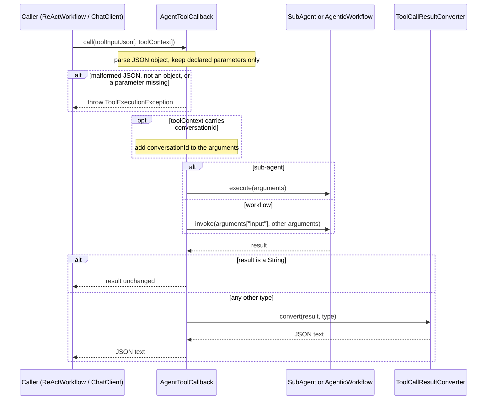

# Agents as tools — `AgentToolCallback`

A Spring AI `ToolCallback` that wraps a `SubAgent` or an `AgenticWorkflow`, so a model can call it
the way it calls any other tool. It is not an eighth pattern: it is an adapter that lets the
existing ones compose. Registered on a `ReActWorkflow`, it turns ReAct into a **supervisor** that
decides at runtime which agent to delegate to next. Because every workflow is an
`AgenticWorkflow`, it also lets workflows nest inside one another.

```java
ToolCallback research = AgentToolCallback.builder()
        .name("research")
        .description("Answers questions from the product documentation. Returns prose.")
        .workflow(ragSubAgent)                     // any AgenticWorkflow
        .build();

ToolCallback translate = AgentToolCallback.builder()
        .name("translate")
        .description("Translates text into another language.")
        .subAgent(translatorAgent)                 // any SubAgent; its template uses {text} and {language}
        .parameter("text", "The text to translate.")
        .parameter("language", "The target language, e.g. French.")
        .build();

String answer = ReActWorkflow.builder()
        .chatClient(chatClient)
        .toolCallbacks(research, translate)
        .build()
        .invoke("Explain our refund policy in French.");
```

A runnable version is the `supervisor` demo — `SupervisorExample` in `:example`:

```bash
./gradlew bootRun --args='--agent.demo=supervisor'
```

---

## Architecture

```mermaid
classDiagram
    direction LR

    class ToolCallback {
        <<interface>>
        +getToolDefinition() ToolDefinition
        +call(String toolInput) String
        +call(String toolInput, ToolContext) String
    }

    class AgentToolCallback {
        +DEFAULT_PARAMETER$ String
        -ToolDefinition definition
        -Map parameters
        -Function target
        -ToolCallResultConverter resultConverter
        +builder() Builder
    }

    class Builder {
        +name(String) Builder
        +description(String) Builder
        +subAgent(SubAgent) Builder
        +workflow(AgenticWorkflow) Builder
        +parameter(String, String) Builder
        +resultConverter(ToolCallResultConverter) Builder
        +build() AgentToolCallback
    }

    class SubAgent~T~ {
        <<interface>>
        +execute(Map context) T
    }

    class AgenticWorkflow~T~ {
        <<interface>>
        +invoke(String input, Map attributes) T
    }

    class ReActWorkflow

    ToolCallback <|.. AgentToolCallback
    AgentToolCallback +-- Builder
    AgentToolCallback --> SubAgent : target, or
    AgentToolCallback --> AgenticWorkflow : target
    ReActWorkflow o--> ToolCallback : tools
```

### Execution



---

## Arguments and context keys

Every declared `parameter(name, description)` becomes a **required string** property of the tool's
JSON input schema (`additionalProperties: false`). With none declared, the tool takes the single
parameter `input`.

| Target | Where each argument goes |
|---|---|
| `subAgent(...)` | Every argument is an entry of the agent's context map. Name parameters after the placeholders in the agent's prompt template and the model fills them directly. |
| `workflow(...)` | `input` is the workflow's input; every other argument is an **attribute** (see `AgenticWorkflow.invoke(String, Map)`). A workflow's own keys take precedence over attributes, so an argument cannot overwrite them. |

Further rules:

- Arguments the model sends but the schema does not declare are dropped.
- A non-string argument — a number, an object — is passed on as its JSON text, because context
  values are strings.
- The sub-agent receives a fresh, mutable map per call. Nothing from the calling workflow's
  context reaches it; the tool's arguments are the whole context.

### `conversationId`

`conversationId` is reserved (see `SubAgent.CONVERSATION_ID`): it decides whose chat memory an
agent reads, so a model must not be able to choose it.

- `parameter("conversationId", ...)` is rejected at build time.
- A `conversationId` argument the model sends is dropped like any other undeclared argument.
- A `conversationId` in the **`ToolContext`** is forwarded. That is how Spring AI's native tool
  calling passes it: `chatClient.prompt()...toolContext(Map.of("conversationId", id))`. Every other
  tool-context entry is ignored.

---

## Results

| Result | Tool response |
|---|---|
| `String` | Returned unchanged. |
| Any other type, e.g. a record | Serialized to JSON by Spring AI's `DefaultToolCallResultConverter`. |
| `null` | `ToolExecutionException`. |

`resultConverter(ToolCallResultConverter)` replaces the default for non-null results — use it to
truncate long output or render a typed result as prose. Spring AI's own default converter is not
used for strings because it would wrap agent prose in JSON quotes and escapes.

---

## Builder reference

| Method | Default | Notes |
|---|---|---|
| `name(String)` | — | **Required.** Must match `[a-zA-Z0-9_-]{1,64}`, the rule OpenAI and Anthropic share. |
| `description(String)` | — | **Required**, non-blank. The only thing the model knows about the agent — say what it does and what it returns. |
| `subAgent(SubAgent<?>)` | — | Exactly one of this and `workflow`. |
| `workflow(AgenticWorkflow<?>)` | — | Exactly one of this and `subAgent`. |
| `parameter(String, String)` | `input` only | Repeatable; declaring a name again replaces its description. Order is kept in the schema. |
| `resultConverter(ToolCallResultConverter)` | String as-is, else JSON | |

### Validation

| Problem | Thrown by | Exception |
|---|---|---|
| `name`, `description` or target not set | `build()` | `NullPointerException` |
| Invalid tool name, blank description | `build()` | `IllegalArgumentException` |
| Workflow target whose declared parameters omit `input` | `build()` | `IllegalArgumentException` |
| Both `subAgent` and `workflow` set | the second setter | `IllegalStateException` |
| Blank or `conversationId` parameter name | `parameter(...)` | `IllegalArgumentException` |

---

## Failure modes

All failures at call time are `ToolExecutionException`s carrying this tool's `ToolDefinition`,
the same contract as Spring AI's method tools.

| Situation | Result |
|---|---|
| Arguments are not valid JSON, or not a JSON object | `ToolExecutionException`, cause `IllegalArgumentException` |
| A declared argument is missing or `null` | `ToolExecutionException` naming the argument |
| The target throws | `ToolExecutionException` whose `getCause()` is the original — a `WorkflowExhaustedException`, `ReviewRejectedException`, … |
| The target throws a `ToolExecutionException` (a nested adapter) | Rethrown unchanged, so `getToolDefinition()` still names the tool that actually failed |
| The target returns `null` | `ToolExecutionException` |

What the caller does with that exception depends on the caller:

- **`ReActWorkflow`** does not contain tool exceptions — the run ends and the exception propagates
  out of `invoke` (see [its guide](react-workflow.md#failure-modes)).
- **Native tool calling** hands it to Spring AI's `ToolExecutionExceptionProcessor`, which by
  default returns the message to the model as the tool result so it can recover.

---

## Gotchas

- **A failing inner agent ends the outer ReAct run.** An inner workflow that exhausts its budget,
  or a `HumanReviewSubAgent` whose reviewer rejects, throws through the supervisor. If the
  supervisor should recover instead, give the inner workflow `ExhaustionPolicy.RETURN_PARTIAL`, or
  wrap the adapter in a `ToolCallback` that catches and returns the error as text.
- **`ReActWorkflow` does not forward `conversationId` to its tools.** It calls `call(actionInput)`
  without a `ToolContext`, so a nested agent with chat memory starts a fresh conversation. Only
  native tool calling forwards it today.
- **Nested budgets multiply.** A supervisor with `maxSteps(10)` delegating to a ReAct worker with
  `maxSteps(10)` can make about 100 model calls in one `invoke`. Size inner budgets small.
- **Output re-enters the prompt.** In ReAct the tool result lands in the scratchpad and is resent on
  every later step. Ask inner agents for concise answers, or truncate with `resultConverter`.
- **One string per parameter.** Typed or optional parameters are not supported. Declare what the
  agent's template needs and describe the expected format in the parameter description.
