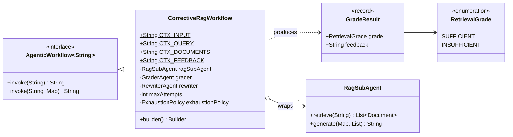
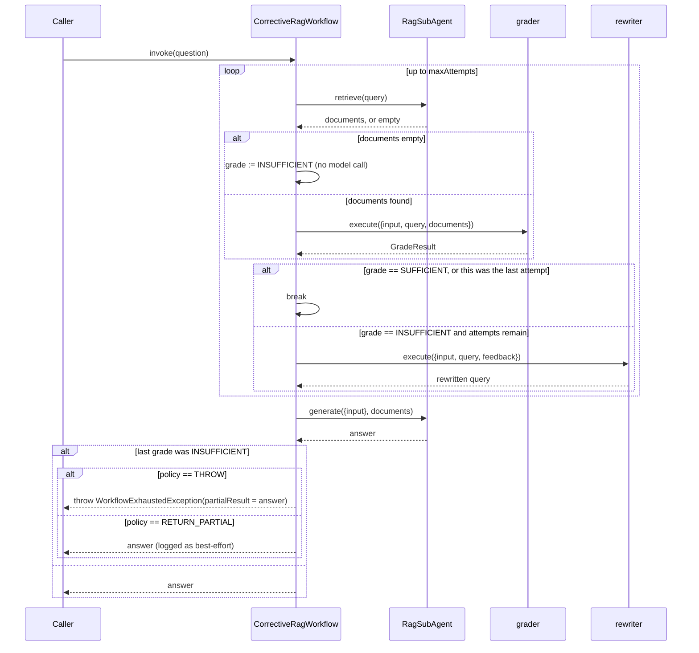

# Corrective / Agentic RAG — `CorrectiveRagWorkflow`

A grade-and-retry loop wrapped around [`RagSubAgent`](rag-sub-agent.md): a grader judges whether
the retrieved passages can actually answer the question, and if not, a rewriter drafts a better
search query and the workflow retrieves again — up to `maxAttempts` times — before generating the
final answer.

**Use it when** `RagSubAgent`'s single retrieval is a coin flip: an ambiguous question, a query
phrased unlike the corpus's vocabulary, or a corpus where some questions simply need a second,
differently-worded search to land on the right passages.

**Don't use it when** the corpus and the questions already line up well — this adds a grader call
(and sometimes a rewriter call) to every answer, for a correction that most questions will never
need. And don't use it for a question that needs *reasoning across* retrievals rather than one
better search; that's a [ReAct](react-workflow.md) loop with a retrieval tool.

The difference from plain `RagSubAgent` in one line: **a bad first retrieval gets a second chance,
instead of the model being asked to answer from the wrong passages.**

---

## Architecture

### Execution

| Step | Detail |
|---|---|
| Retrieve | `RagSubAgent.retrieve(query)` — the original question on attempt 1, the rewriter's output after. Never re-run for the query that was just graded: the final `generate` call reuses that attempt's documents. |
| Grade | Skipped when retrieval is empty — graded `INSUFFICIENT` directly, for the same reason `RagSubAgent` itself skips generation on empty retrieval: there is nothing to grade and the call would be billed for a guess. Otherwise the grader reads the question and the formatted passages. |
| Rewrite | Skipped on the final attempt, since there is no further retrieval left to use it for. |
| Generate | `RagSubAgent.generate(context, documents)` over whichever documents the last attempt retrieved — empty documents still short-circuit to `noDocumentsAnswer`, same as plain `RagSubAgent`. |

---

## Context keys

| Key | Constant | Meaning |
|---|---|---|
| `input` | `CTX_INPUT` | The original question, unchanged across every attempt. Also the key the final `generate` call relies on — the wrapped `RagSubAgent`'s prompt template must read the question from `{input}` (its default template does), regardless of that agent's own `queryKey`. |
| `query` | `CTX_QUERY` | The current attempt's search query: the original question on attempt 1, the rewriter's output after. |
| `documents` | `CTX_DOCUMENTS` | The current attempt's formatted passages, visible to the grader. |
| `feedback` | `CTX_FEEDBACK` | The grader's explanation of what was missing, visible to the rewriter. |

---

## Failure handling

This workflow is bounded by `maxAttempts` (default `3`) and honours the library-wide
`ExhaustionPolicy` convention, the same shape
[`IterativeRefinementWorkflow`](iterative-refinement-workflow.md) uses for an unpassed draft: the
best-effort answer is computed either way, generated from whatever the last attempt retrieved.

| Policy | Effect |
|---|---|
| `THROW` (default) | `WorkflowExhaustedException` is thrown, carrying the best-effort answer as `getPartialResult()` and `maxAttempts` as `getLimit()`. |
| `RETURN_PARTIAL` | The best-effort answer is returned directly, with a warning logged. |

Unlike [`VotingAgentOrchestrator`](voting-agent-orchestrator.md)'s `DEGRADE` policy, there is no
placeholder to worry about here — the answer is always a real, grounded `RagSubAgent.generate`
call, just possibly over passages the grader rejected.

---

## Builder reference

| Method | Default | Notes |
|---|---|---|
| `ragSubAgent(RagSubAgent)` | — | **Required.** Its prompt template must read the question from `{input}`. All retrieval configuration (`topK`, `similarityThreshold`, `vectorStore`) lives on this agent, not on the workflow. |
| `chatClient(ChatClient)` | — | **Required.** Backs the internal grader and rewriter agents. |
| `graderPromptTemplate(String)` | built-in | Must contain `{input}` and `{documents}`. |
| `rewriterPromptTemplate(String)` | built-in | Must contain `{input}`, `{query}` and `{feedback}`. |
| `maxAttempts(int)` | `3` | Must be at least 1. At `1`, the grader still runs but there is no budget left to act on an `INSUFFICIENT` grade. |
| `exhaustionPolicy(ExhaustionPolicy)` | `THROW` | See above. |

### Validation

`build()` throws `NullPointerException` for a missing `ragSubAgent` or `chatClient`, and
`IllegalArgumentException` for `maxAttempts < 1`.

---

## Gotchas

- **The wrapped `RagSubAgent`'s `queryKey` is never used by this workflow.** Retrieval goes
  through `retrieve(String)`, which takes the query directly rather than through the context map,
  and generation goes through `generate(Map, List)`, which only needs whatever the prompt template
  references. A custom template on the wrapped agent must still read the question from `{input}`.
- **Grading costs a model call per attempt** (skipped only when retrieval itself came back empty),
  and a rewrite costs another. A `maxAttempts` of 3 is up to 2 grader calls plus 2 rewriter calls
  beyond the single call plain `RagSubAgent` would have made — worth it only where bad first
  retrievals are common enough to matter.
- **The grader and rewriter are not pluggable `SubAgent`s** the way a workflow's worker or
  synthesizer is — they are built internally from the shared `chatClient`, with an overridable
  prompt template each, mirroring `OrchestratorWorkersWorkflow`'s internal orchestrator agent. Swap
  the prompt, not the implementation, to change how grading or rewriting behaves.
- **No semantic grading of individual passages** — the grader judges the whole retrieved set at
  once, not passage-by-passage. A retrieval with one great passage buried among several irrelevant
  ones is graded as a whole, same as plain `RagSubAgent` renders the whole set into one prompt.
