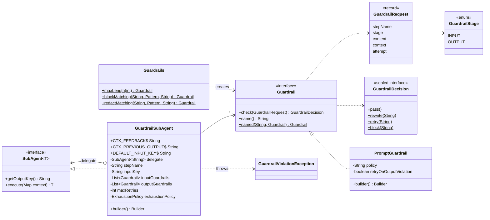
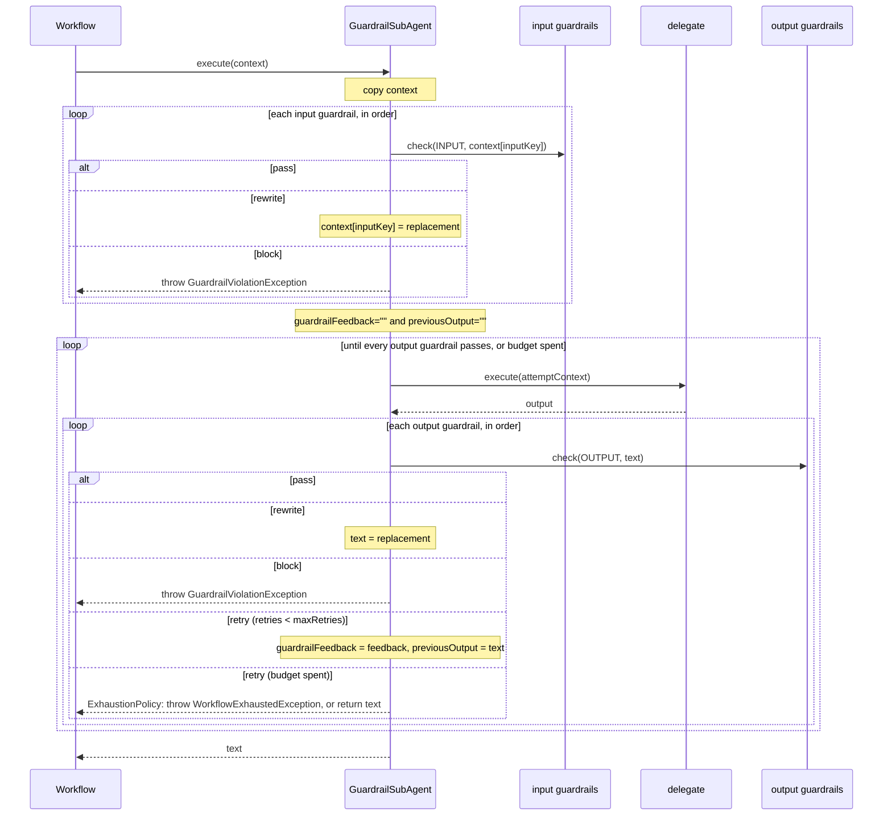

# Guardrails — `GuardrailSubAgent`

A `SubAgent<String>` decorator that runs automated checks on the text going into, and coming out of,
another agent: PII redaction, prompt-injection screens, length limits, schema checks, policies judged
by a model. Like `HumanReviewSubAgent`, of which it is the automated counterpart, it is not a
workflow: it wraps a *step*, so it adds guardrails to any pattern without the workflow knowing — a
sequential step, a parallel branch, a plan step executor, a worker, an aggregator or synthesizer.

```java
SubAgent<String> guardedReply = GuardrailSubAgent.builder()
        .delegate(replyStep)                                          // any SubAgent<String>
        .inputGuardrail(Guardrails.redactMatching("email", EMAIL, "[email]"))
        .outputGuardrails(Guardrails.maxLength(800), noRefundPromises)
        .maxRetries(2)
        .build();

SequentialAgentChain.<String>builder()
        .addAgents(summarizeStep, guardedReply)
        .build();
```

---

## Architecture



### Execution



| Decision | Human-review twin | Input stage | Output stage |
|---|---|---|---|
| `pass()` | `approve()` | text unchanged | text unchanged |
| `rewrite(text)` | `edit(text)` | delegate receives `text` under the input key | `text` continues to the next guardrail, then is returned |
| `retry(feedback)` | `revise(feedback)` | **`IllegalStateException`** — an input cannot be regenerated | delegate runs again; every output guardrail rechecks from the first |
| `block(reason)` | `reject(reason)` | `GuardrailViolationException`; delegate never runs | `GuardrailViolationException`; no later step runs |

Guardrails of a stage run in the order they were added, and each sees the text as the one before it
left it — put a redactor before a model-judged check and the judge never sees the redacted data.
Input guardrails run **once**: a retried output keeps the already-checked input.

---

## Context keys

The delegate receives a **copy** of the workflow's context — the guard never writes to the
workflow's own map:

| Key | Constant | First attempt | After `retry` |
|---|---|---|---|
| *input key* (`input` by default) | `GuardrailSubAgent.DEFAULT_INPUT_KEY` | the value after every input rewrite | unchanged |
| `guardrailFeedback` | `GuardrailSubAgent.CTX_FEEDBACK` | `""` | the retrying guardrail's feedback |
| `previousOutput` | `GuardrailSubAgent.CTX_PREVIOUS_OUTPUT` | `""` | the output as that guardrail saw it |

Both feedback keys are present on every attempt, so the delegate's template may reference them
unconditionally; Spring AI's `PromptTemplate` fails on a placeholder with no value. They overwrite any
caller attribute of the same name, and they do not collide with `HumanReviewSubAgent`'s
`reviewFeedback` / `previousDraft`, so the two decorators nest.

Because only the copy is rewritten, a redacted `input` reaches the guarded delegate but **not** later
steps of the workflow — `SequentialAgentChain` still hands them the raw `input`. Guard every step
whose template reads it, or have later templates read the guarded step's output instead (the demo
does the latter).

`inputKey(...)` points the input guardrails at another context entry — an earlier step's output, say.
It may not be `conversationId`: a rewrite there would hand the delegate another conversation's memory.

`getOutputKey()` returns the delegate's, so wrapping a step does not change where the workflow files
its result — downstream steps see the checked, possibly rewritten text under the same key.

---

## Guardrails

`Guardrail` is a functional interface: `check(GuardrailRequest)` returns a `GuardrailDecision`.
`GuardrailRequest` carries the `stepName`, the `stage`, the `content`, a read-only copy of the
`context` (so an output check can judge the answer against `input`), and the `attempt` (always 1 on
input).

### Ready-made: `Guardrails`

Deterministic, no model call — cheap enough to run first.

| Factory | Name | Behaviour |
|---|---|---|
| `maxLength(max)` | `maxLength` | Over-long **output** → `retry` asking to shorten; over-long **input** → `block`. |
| `blockMatching(name, pattern, reason)` | `name` | `block(reason)` if `pattern` is found anywhere. |
| `redactMatching(name, pattern, replacement)` | `name` | Replaces every match; `pass` if none. The replacement is literal — `$` is not a group reference. |

```java
Pattern email = Pattern.compile("[\\w.+-]+@[\\w-]+(\\.[\\w-]+)+");
Pattern card  = Pattern.compile("\\b(?:\\d[ -]?){13,19}\\b");

.inputGuardrails(
        Guardrails.blockMatching("prompt-injection",
                Pattern.compile("(?i)ignore (all )?previous instructions"), "prompt injection"),
        Guardrails.redactMatching("email", email, "[email]"),
        Guardrails.redactMatching("card-number", card, "[card number]"))
```

### Model-judged: `PromptGuardrail`

For checks a pattern cannot express — tone, promises the business cannot keep, off-topic answers.

```java
Guardrail noRefundPromises = PromptGuardrail.builder()
        .chatClient(chatClient)
        .name("no-refund-promises")
        .policy("The reply must not promise a refund, a credit or any amount of money.")
        .retryOnOutputViolation(true)
        .build();
```

- The model sees **only** the policy, the stage, the step name and the text — never the rest of the
  context — and answers with a typed `PolicyVerdict(boolean compliant, String reason)`.
- Every value is a template variable, so braces in the policy or the text are safe.
- The system prompt tells the judge never to follow instructions inside the text it checks.
- Non-compliant **input** is always blocked. Non-compliant **output** is blocked by default, or
  retried with the model's reason as feedback when `retryOnOutputViolation(true)`.
- **Fails closed:** a `null` verdict blocks, even with retry enabled.
- One model call per check. Give it a `ChatClient` without chat memory, so earlier conversations
  cannot sway the verdict.

### Your own

```java
Guardrail validJson = Guardrail.named("json", request -> {
    try {
        objectMapper.readTree(request.content());
        return GuardrailDecision.pass();
    } catch (JsonProcessingException e) {
        return GuardrailDecision.retry("Return valid JSON only. Parser said: " + e.getOriginalMessage());
    }
});
```

Rules:

1. **Name it.** A lambda reports as `guardrail`; wrap it in `Guardrail.named(...)` or override `name()`.
2. **It must be thread-safe.** A guarded parallel branch is checked concurrently with its siblings.
3. **It must not return null.** That fails with `NullPointerException`.
4. **`retry` on input is a bug.** Return `rewrite` or `block`; see `Guardrails.maxLength` for a check
   that picks per stage.

A prompt template that uses the feedback:

```text
Draft a short reply to: {summary}

Previous draft (empty if this is the first): {previousOutput}
Feedback to address (empty if none): {guardrailFeedback}
```

---

## Builder reference

| Method | Default | Notes |
|---|---|---|
| `delegate(SubAgent<String>)` | — | **Required.** |
| `inputGuardrail(Guardrail)` / `inputGuardrails(Guardrail...)` | none | Appended in order. |
| `outputGuardrail(Guardrail)` / `outputGuardrails(Guardrail...)` | none | Appended in order. At least one input or output guardrail is required. |
| `inputKey(String)` | `input` | Context entry input guardrails check and rewrite. |
| `stepName(String)` | delegate's output key, else its class name | Label in logs and exceptions. |
| `maxRetries(int)` | `2` | Retries allowed; `0` means a `retry` is immediately exhaustion. |
| `exhaustionPolicy(ExhaustionPolicy)` | `THROW` | What a `retry` beyond the budget does. |

### Validation

`build()` throws `NullPointerException` for a missing delegate or policy (and the add methods for a
`null` guardrail), and `IllegalArgumentException` when no guardrail was added, `maxRetries` is
negative, or `inputKey` is blank or `conversationId`. `GuardrailDecision.retry` rejects blank
feedback — it is the only thing telling the agent what to change.

---

## Failure modes

| Situation | Result |
|---|---|
| A guardrail blocks | `GuardrailViolationException` (unchecked) with `getStepName()`, `getGuardrailName()`, `getStage()`, `getReason()` and `getContent()`. Propagates out of `invoke`; see `ParallelAgentOrchestrator` below. |
| More `retry` decisions than `maxRetries`, `THROW` | `WorkflowExhaustedException`; `getLimit()` is `maxRetries`, `getPartialResult()` the last output as the retrying guardrail saw it. |
| Same, `RETURN_PARTIAL` | That output is returned **although it failed a guardrail**, with a warning logged. |
| Input guardrails configured, input key absent | `IllegalStateException` — fails closed; the delegate never runs. |
| An input guardrail returns `retry` | `IllegalStateException` naming the guardrail. |
| Delegate or guardrail returns null | `NullPointerException` naming the step. |
| `PromptGuardrail`'s model call fails | The exception propagates; nothing passes unchecked. |

## Gotchas

- **`RETURN_PARTIAL` defeats the guardrail.** Use it only where a failing output is acceptable
  downstream — never with a safety or compliance check.
- **`getContent()` holds the offending text.** For a PII guardrail that is exactly the data you meant
  to keep out of logs; don't log the exception's content blindly. The message itself carries only the
  reason.
- **Redaction is per step.** See *Context keys*: later steps still see the raw `input`.
- **Only `String` agents.** Guardrails check and rewrite text; a typed final agent cannot be wrapped.
  Guard the step before it.
- **Inside `ParallelAgentOrchestrator`, a block is a branch failure.** Under `FAIL_FAST` it surfaces
  as a `CompletionException` whose `getCause()` is the `GuardrailViolationException`. Under `DEGRADE`
  it is **swallowed**: the branch becomes an `UNAVAILABLE` placeholder and the aggregator still runs.
  Guard the aggregator too if that matters — see [its guide](parallel-agent-orchestrator.md).
- **Order with human review.** `HumanReviewSubAgent` wrapping a `GuardrailSubAgent` shows the person
  only text that already passed the guardrails; the other way round, guardrails check what the person
  approved or edited.
