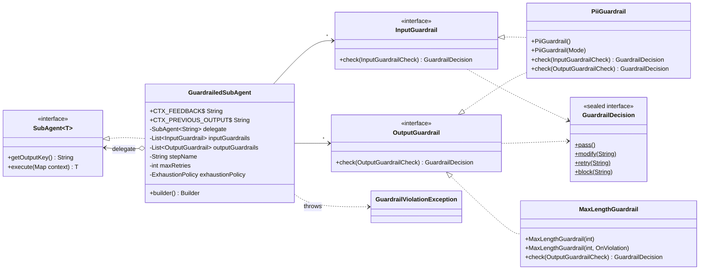
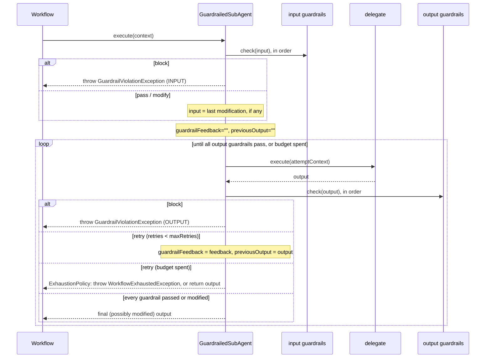

# Guardrails — `GuardrailedSubAgent`

A `SubAgent<String>` decorator that runs automated checks around another agent's input and
output — the automated counterpart of [`HumanReviewSubAgent`](human-review-sub-agent.md), with
code standing in for the person. It is not an eighth workflow: it wraps a *step*, so it adds
guardrails to any of the six patterns without them knowing — a sequential step, a parallel branch,
the plan step executor, an aggregator or synthesizer.

```java
PiiGuardrail pii = new PiiGuardrail();
SubAgent<String> guardedReply = GuardrailedSubAgent.builder()
        .delegate(replyStep)                      // any SubAgent<String>
        .inputGuardrail(pii)                       // checked before replyStep runs
        .outputGuardrail(pii)                      // checked after
        .outputGuardrail(new MaxLengthGuardrail(400))
        .maxRetries(2)
        .build();

SequentialAgentChain.<String>builder()
        .addAgents(summarizeStep, guardedReply)
        .build();
```

---

## Architecture



### Execution



| Decision | Effect | Model calls |
|---|---|---|
| `pass()` | The content moves on unchanged. | none further |
| `modify(text)` | `text` replaces the content; later guardrails in the same pass see it. | none further |
| `retry(feedback)` | **Output guardrails only.** The delegate runs again with the feedback; every output guardrail re-checks the new output from the start. | one more |
| `block(reason)` | `GuardrailViolationException` propagates out of `invoke`; no later step runs. | none further |

---

## Context keys

The delegate receives a **copy** of the workflow's context with the (possibly modified) `input`
and two keys added:

| Key | Constant | First attempt | After `retry` |
|---|---|---|---|
| `guardrailFeedback` | `GuardrailedSubAgent.CTX_FEEDBACK` | `""` | the guardrail's feedback |
| `previousOutput` | `GuardrailedSubAgent.CTX_PREVIOUS_OUTPUT` | `""` | the output sent back |

Both are present on every attempt, so the delegate's template may reference them unconditionally;
Spring AI's `PromptTemplate` fails on a placeholder with no value. Every other key the workflow put
in scope for the wrapped slot is still available.

`getOutputKey()` returns the delegate's, so wrapping a step does not change where the workflow
files its result — downstream steps see the guarded text under the same key.

---

## Guardrails

Both `InputGuardrail` and `OutputGuardrail` are functional interfaces, so an inline lambda is
enough for a simple rule. The library ships two ready-made checks; any other rule — a schema
validator, a policy classifier backed by its own LLM call — is the application's to supply, as the
model provider is.

### `PiiGuardrail`

Looks for a handful of common PII shapes with plain regular expressions — email addresses, US
Social Security numbers, credit-card-looking digit runs, and phone numbers. One instance
implements **both** `InputGuardrail` and `OutputGuardrail`, so the same check can gate a step's
input and its output:

```java
PiiGuardrail pii = new PiiGuardrail();                       // redacts by default
PiiGuardrail strict = new PiiGuardrail(PiiGuardrail.Mode.BLOCK);
```

- `Mode.REDACT` (default) — each match is replaced with `[REDACTED:<CATEGORY>]` and the check
  returns `modify(...)`.
- `Mode.BLOCK` — any match returns `block(...)` naming the categories found.

**Demonstration-level, not a compliance tool.** The patterns are deliberately simple — no Luhn
check on card numbers, no exhaustive phone formats, no exemption for look-alike text that is not
actually PII — and it runs no model call, so `:api` stays provider-free.

### `MaxLengthGuardrail`

Bounds how long an output may be:

```java
new MaxLengthGuardrail(400);                                           // retries by default
new MaxLengthGuardrail(400, MaxLengthGuardrail.OnViolation.BLOCK);
```

Within the limit it passes the output through. Over the limit, `OnViolation.RETRY` (default) asks
for a retry with the overage in the feedback — a self-correction loop with no separate evaluator
agent, the same shape `IterativeRefinementWorkflow` uses. `OnViolation.BLOCK` rejects an over-long
output outright instead.

### Your own guardrail

```java
InputGuardrail noShouting = check ->
        check.input().equals(check.input().toUpperCase()) && check.input().length() > 20
                ? GuardrailDecision.block("all-caps input")
                : GuardrailDecision.pass();

OutputGuardrail mustMentionRefund = check ->
        check.output().toLowerCase().contains("refund")
                ? GuardrailDecision.pass()
                : GuardrailDecision.retry("the reply must mention the refund process");
```

Rules:

1. **Thread-safe.** A guarded parallel branch is checked concurrently with its siblings.
2. **Must not return null.** That fails with `NullPointerException`.
3. **`retry()` from an `InputGuardrail` is a misconfiguration.** Nothing has executed yet to
   retry; `GuardrailedSubAgent` fails fast with `IllegalStateException` rather than guess what was
   meant.

A prompt template that uses the feedback:

```text
Draft a short reply to: {input}

Previous draft (empty if this is the first): {previousOutput}
Guardrail feedback to address (empty if none): {guardrailFeedback}
```

---

## Builder reference

| Method | Default | Notes |
|---|---|---|
| `delegate(SubAgent<String>)` | — | **Required.** |
| `inputGuardrail(InputGuardrail)` / `inputGuardrails(InputGuardrail...)` | none | Run in the given order against `input`, before the delegate executes. |
| `outputGuardrail(OutputGuardrail)` / `outputGuardrails(OutputGuardrail...)` | none | Run in the given order against the delegate's result. |
| `stepName(String)` | delegate's output key, else its class name | Label shown in `InputGuardrailCheck` / `OutputGuardrailCheck`. |
| `maxRetries(int)` | `1` | Retries allowed after `retry()`; `0` means the first output must pass (or be modified by) every output guardrail. |
| `exhaustionPolicy(ExhaustionPolicy)` | `THROW` | What a `retry` beyond the budget does. |

### Validation

`build()` throws `NullPointerException` for a missing delegate or policy, `IllegalStateException`
if neither an input nor an output guardrail was added, and `IllegalArgumentException` for a
negative `maxRetries`. `GuardrailDecision.retry` rejects blank feedback — it is the only thing
telling the delegate what to change.

---

## Failure modes

| Situation | Result |
|---|---|
| A guardrail blocks | `GuardrailViolationException` (unchecked) with `getStepName()`, `getStage()` and `getBlockedContent()`. Propagates out of `invoke` unchanged. |
| An `InputGuardrail` returns `retry(...)` | `IllegalStateException` — misconfiguration, fails immediately. |
| More `retry` decisions than `maxRetries`, `THROW` | `WorkflowExhaustedException`; `getLimit()` is `maxRetries`, `getPartialResult()` the last output. |
| Same, `RETURN_PARTIAL` | The last output is returned **unvalidated**, with a warning logged. |
| Delegate returns null | `NullPointerException` naming the step. |
| A guardrail returns null | `NullPointerException` naming the step. |

## Gotchas

- **`RETURN_PARTIAL` defeats the gate.** It lets an output that never passed every output
  guardrail through once the budget is spent. Use it only where that is acceptable downstream.
- **A `modify` is not re-checked by earlier guardrails.** Guardrails run once per pass, in order;
  a later guardrail sees an earlier one's fix, but the earlier one does not see the later one's.
  Order guardrails so the ones most likely to need a clean slate run last, or combine both checks
  into one guardrail (as `PiiGuardrail` does for input and output) when they must agree.
- **Only `String` agents.** The checks worth writing here work on text; a typed final agent cannot
  be wrapped. Guard the step before it instead.
- **Inside `ParallelAgentOrchestrator`, a block is a branch failure.** Under `FAIL_FAST` it
  surfaces as a `CompletionException` whose `getCause()` is the `GuardrailViolationException`.
  Under `DEGRADE` it is **swallowed**: the branch becomes an
  `UNAVAILABLE - this analysis did not complete: ...` placeholder and the aggregator still runs —
  see [its guide](parallel-agent-orchestrator.md).
