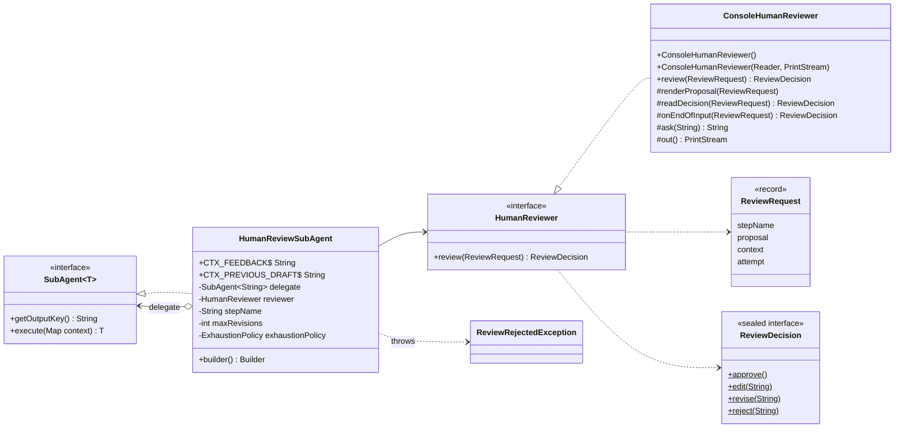
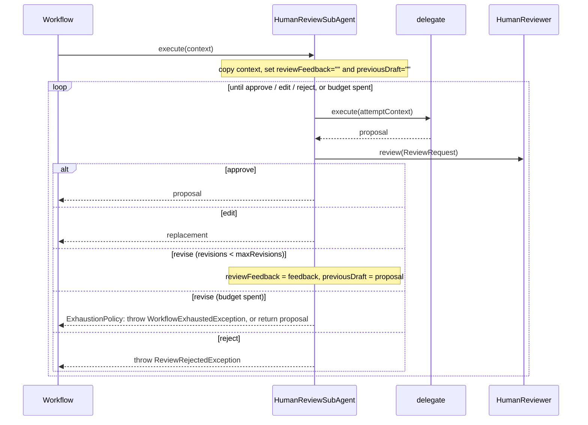

# Human-in-the-loop — `HumanReviewSubAgent`

A `SubAgent<String>` decorator that holds another agent's output for a person to approve before the
workflow may use it. It is not a seventh workflow: it wraps a *step*, so it adds an approval gate to
any of the six patterns without them knowing — a sequential step, a parallel branch, the plan step
executor, an aggregator or synthesizer.

```java
SubAgent<String> reviewedReply = HumanReviewSubAgent.builder()
        .delegate(replyStep)                      // any SubAgent<String>
        .reviewer(request -> askOperator(request)) // your channel to a human
        .maxRevisions(3)
        .build();

SequentialAgentChain.<String>builder()
        .addAgents(summarizeStep, reviewedReply)
        .build();
```

---

## Architecture



### Execution



| Decision | Effect | Model calls |
|---|---|---|
| `approve()` | The proposal is returned unchanged. | none further |
| `edit(text)` | `text` is returned in place of the proposal. | none further |
| `revise(feedback)` | The delegate runs again with the feedback; its new proposal is reviewed. | one more |
| `reject(reason)` | `ReviewRejectedException` propagates out of `invoke`; no later step runs. | none further |

---

## Context keys

The delegate receives a **copy** of the workflow's context — the gate never writes to the
workflow's own map — with two keys added:

| Key | Constant | First attempt | After `revise` |
|---|---|---|---|
| `reviewFeedback` | `HumanReviewSubAgent.CTX_FEEDBACK` | `""` | the reviewer's feedback |
| `previousDraft` | `HumanReviewSubAgent.CTX_PREVIOUS_DRAFT` | `""` | the proposal sent back |

Both are present on every attempt, so the delegate's template may reference them unconditionally;
Spring AI's `PromptTemplate` fails on a placeholder with no value. They overwrite any caller
attribute of the same name. Every other key the workflow put in scope for the wrapped slot is still
available.

`getOutputKey()` returns the delegate's, so wrapping a step does not change where the workflow files
its result — downstream steps see the approved or edited text under the same key.

---

## Reviewers

`HumanReviewer` is a functional interface and the only seam to a person. The library ships one
implementation, `ConsoleHumanReviewer`, for interactive runs; any other channel — Slack, a ticket
queue, a web form — is the application's to supply, as the model provider is.

### `ConsoleHumanReviewer`

Shows the proposal on a text console and asks for `[a]pprove, [e]dit, [r]evise, re[j]ect`.

```java
new ConsoleHumanReviewer();                                     // System.in / System.out
new ConsoleHumanReviewer(new StringReader("a
"), printStream);  // any Reader / PrintStream
```

**Interactive use only.** In a web service or scheduled job standard input is closed or shared, so
the first review hits end-of-input and fails the run. That is deliberate: a gate with no human
attached must not approve anything.

`review` is `final`, so these rules hold for every subclass:

- **One review at a time.** `review` is `synchronized`; gated parallel branches queue instead of
  interleaving prompts on one console.
- **Revisions need feedback.** Blank feedback is asked again, never sent.
- **No human, no approval.** End-of-input goes to `onEndOfInput`, never to an approve.
- **ASCII output.** `System.out` uses the platform charset, so non-ASCII decoration arrives as
  replacement characters on a Windows console.

Extend it through the protected hooks:

| Hook | Default | Override to |
|---|---|---|
| `renderProposal(request)` | header, proposal, footer | show `input` or other context, truncate long drafts |
| `readDecision(request)` | single-key loop | change key bindings or wording; build on `ask(prompt)` |
| `onEndOfInput(request)` | throws `IllegalStateException` | return `reject(...)` for a quieter stop — never `approve()` |

`ask(prompt)` and `out()` are `final` helpers for those overrides. The `review` demo extends it to
print the customer's complaint above the draft:

```java
class ComplaintAwareReviewer extends ConsoleHumanReviewer {
    @Override
    protected void renderProposal(ReviewRequest request) {
        out().println("Customer wrote: " + request.context().get("input"));
        super.renderProposal(request);
    }
}
```

### Your own channel

```java
HumanReviewer reviewer = request -> {
    Ticket t = queue.open(request.stepName(), request.proposal(), request.context().get("input"));
    Verdict v = t.await(Duration.ofHours(4));     // block; time out on your own terms
    return switch (v.kind()) {
        case OK      -> ReviewDecision.approve();
        case CHANGED -> ReviewDecision.edit(v.text());
        case REDO    -> ReviewDecision.revise(v.comment());
        case BLOCK   -> ReviewDecision.reject(v.comment());
    };
};
```

Rules:

1. **`review` is synchronous.** It runs on the workflow's thread and blocks it. An asynchronous
   channel must wait for its answer; timing out is the reviewer's decision — return `reject` or throw.
2. **It must be thread-safe.** A gated parallel branch is reviewed concurrently with its siblings.
3. **It must not return null.** That fails with `NullPointerException`.

A prompt template that uses the feedback:

```text
Draft a short reply to: {input}

Previous draft (empty if this is the first): {previousDraft}
Reviewer feedback to address (empty if none): {reviewFeedback}
```

---

## Builder reference

| Method | Default | Notes |
|---|---|---|
| `delegate(SubAgent<String>)` | — | **Required.** |
| `reviewer(HumanReviewer)` | — | **Required.** |
| `stepName(String)` | delegate's output key, else its class name | Label shown in `ReviewRequest`. |
| `maxRevisions(int)` | `3` | Revisions allowed; `0` means the first proposal must be approved, edited or rejected. |
| `exhaustionPolicy(ExhaustionPolicy)` | `THROW` | What a `revise` beyond the budget does. |

### Validation

`build()` throws `NullPointerException` for a missing delegate, reviewer or policy, and
`IllegalArgumentException` for a negative `maxRevisions`. `ReviewDecision.revise` rejects blank
feedback — it is the only thing telling the agent what to change.

---

## Failure modes

| Situation | Result |
|---|---|
| Reviewer rejects | `ReviewRejectedException` (unchecked) with `getStepName()` and `getRejectedProposal()`. Every workflow except `ParallelAgentOrchestrator` lets it propagate unchanged — see below. |
| More `revise` decisions than `maxRevisions`, `THROW` | `WorkflowExhaustedException`; `getLimit()` is `maxRevisions`, `getPartialResult()` the last proposal. |
| Same, `RETURN_PARTIAL` | The last proposal is returned **unapproved**, with a warning logged. |
| Delegate returns null | `NullPointerException` naming the step. |
| Reviewer returns null | `NullPointerException` naming the step. |

## Gotchas

- **`RETURN_PARTIAL` defeats the gate.** It lets unapproved text through once the budget is spent.
  Use it only where that is acceptable downstream.
- **Only `String` agents.** A person reviews and edits text; a typed final agent cannot be wrapped.
  Gate the step before it instead.
- **Inside `ParallelAgentOrchestrator`, a rejection is a branch failure.** Under `FAIL_FAST` it
  surfaces as a `CompletionException` whose `getCause()` is the `ReviewRejectedException`. Under
  `DEGRADE` it is **swallowed**: the branch becomes an `UNAVAILABLE - this analysis did not complete: ...` placeholder and the aggregator
  still runs. A `branchTimeout` also applies to the time a human takes to answer, so leave it unset
  or generous for gated branches — see [its guide](parallel-agent-orchestrator.md).
- **`bootRun` and stdin.** Gradle does not connect `bootRun` to the console by default;
  `:example` sets `standardInput = System.in` so `ConsoleHumanReviewer` can read. Any other
  application using it under `bootRun` needs the same line.
