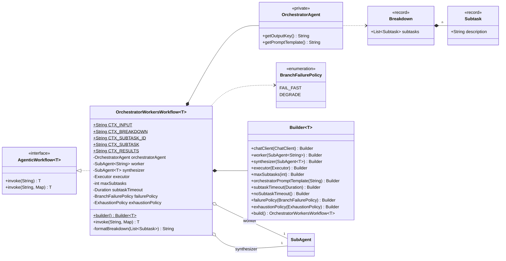
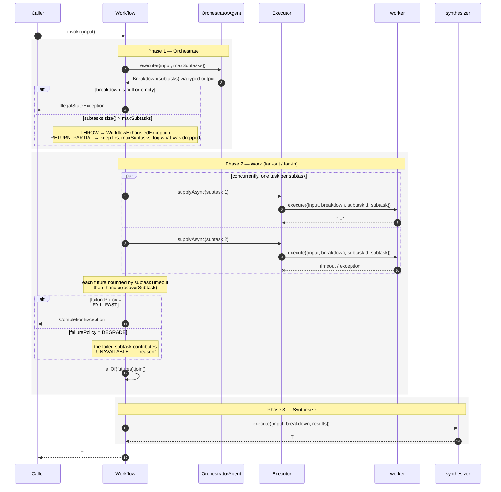

# Orchestrator-workers — `OrchestratorWorkersWorkflow<T>`

An orchestrator decomposes the task into however many independent subtasks it judges necessary, at
runtime. A single worker agent is invoked once per subtask, concurrently. A synthesizer folds every
result into one typed answer.

**Use it when** the right number of parallel pieces depends on the input itself — "write a product
page" might need three sections, "write a product page for a five-SKU bundle" might need eight —
so a fixed branch list would either waste calls or miss coverage.

**Don't use it when** the branches are known in advance and don't change shape per request — that's
[parallel orchestration](parallel-agent-orchestrator.md), with different specialist agents wired at
build time instead of one agent run N dynamic times. And don't use it when the subtasks genuinely
depend on each other's output — that's [plan & execute](plan-and-execute-workflow.md), which runs
its steps in sequence specifically so each one can see what came before.

The difference from the parallel orchestrator in one line: **the fan-out width and content are
decided by an LLM call, not by the builder.** The difference from plan & execute in one line:
**subtasks run concurrently because they are independent, not in sequence because they depend on
each other.**

---

## Architecture



The orchestrator is internal — you supply a `ChatClient` and, optionally, a prompt template. There
is exactly **one** worker, reused for every subtask; that is what lets the fan-out width vary per
call. The synthesizer is yours and types the workflow.

### Execution



Cost is `1 + n + 1` LLM calls for a breakdown of *n* subtasks — orchestrate, each subtask (in
parallel), synthesis. Unlike plan & execute, the *n* subtask calls run concurrently, so wall-clock
is roughly orchestrate + slowest subtask + synthesize, not orchestrate + sum of subtasks + synthesize.

---

## Context keys

**Orchestrator** (internal):

| Key | Value |
|---|---|
| `input` | The original task. |
| `maxSubtasks` | The configured budget, as a string — the default template asks for "between 1 and {maxSubtasks} subtasks". |

**Worker**, once per subtask, concurrently:

| Key | Value | Constant |
|---|---|---|
| `input` | The original task. | `CTX_INPUT` |
| `breakdown` | The whole breakdown, formatted `1. …\n2. …` — every worker sees how its piece fits the whole. | `CTX_BREAKDOWN` |
| `subtaskId` | This subtask's number, 1-based, as a string. | `CTX_SUBTASK_ID` |
| `subtask` | This subtask's description. | `CTX_SUBTASK` |

A worker never sees another worker's *result* — only the breakdown's text. That is the boundary
that makes concurrent execution safe: subtasks must not depend on each other's output, only on
knowing the shape of the whole.

**Synthesizer**, once at the end:

| Key | Value | Constant |
|---|---|---|
| `input` | The original task. | `CTX_INPUT` |
| `breakdown` | The formatted breakdown. | `CTX_BREAKDOWN` |
| `results` | Every subtask's result labelled `Subtask N — <description>:` then the text, declaration order. | `CTX_RESULTS` |

---

## Implementing one

### 1. Write a worker that orients itself from the context

One agent runs every subtask, so its prompt must read its assignment from the context, the same
way `PlanAndExecuteWorkflow`'s step executor does:

```java
DefaultPromptSubAgent worker = DefaultPromptSubAgent.builder()
        .chatClient(chatClient)
        .outputKey("workerResult")
        .systemPrompt("""
                You are a skilled writer completing one section of a larger document.
                Focus exclusively on your assigned subtask. Stay consistent with the overall
                breakdown, but do not repeat content that belongs to another subtask.
                """)
        .promptTemplate("""
                Overall task: {input}

                Full breakdown of subtasks:
                {breakdown}

                Your subtask ({subtaskId}): {subtask}

                Write this section now.
                """)
        .build();
```

### 2. Write a synthesizer

```java
DefaultPromptSubAgent synthesizer = DefaultPromptSubAgent.builder()
        .chatClient(chatClient)
        .systemPrompt("""
                You are an editor assembling a final document from independently drafted
                sections. Smooth over any inconsistencies in tone, remove duplication between
                sections, and present one cohesive result.
                """)
        .promptTemplate("""
                Overall task: {input}

                Breakdown that was worked:
                {breakdown}

                Drafted sections:
                {results}

                Produce the final, cohesive document.
                """)
        .build();
```

As with `PlanAndExecuteWorkflow`, this slot types the workflow — `synthesizer(SubAgent<T>)` accepts
a typed agent, so `OrchestratorWorkersWorkflow<Report>` is one `AbstractPromptSubAgent<Report>` away.

### 3. Supply an `Executor` and assemble

```java
AgenticWorkflow<String> workflow = OrchestratorWorkersWorkflow.<String>builder()
        .chatClient(chatClient)   // used by the internal orchestrator
        .worker(worker)
        .synthesizer(synthesizer)
        .executor(executor)
        .maxSubtasks(6)
        .build();

String document = workflow.invoke(task);
```

The executor is mandatory, exactly as in `ParallelAgentOrchestrator`, and the same virtual-thread
advice applies — subtasks are I/O-bound HTTP calls:

```java
@Bean
public Executor executor() {
    return Executors.newVirtualThreadPerTaskExecutor();
}
```

Working end-to-end version:
[`OrchestratorWorkersWorkflowExample`](../../example/src/main/java/com/ronald/agent/example/OrchestratorWorkersWorkflowExample.java).

### 4. Optionally steer the orchestrator

```java
.orchestratorPromptTemplate("""
        Break this support ticket into independent investigation threads.

        Rules:
        - Each thread must be answerable without the others' findings.
        - Produce between 1 and {maxSubtasks} threads.

        Ticket: {input}
        """)
```

Keep both `{input}` and `{maxSubtasks}` — the orchestrator has no other way to learn the budget.
As with the planner in `PlanAndExecuteWorkflow`, this is not validated at build time; a template
missing `{maxSubtasks}` simply renders without it, and the breakdown may overrun.

---

## Timeouts and failure policy

```java
OrchestratorWorkersWorkflow.<String>builder()
        .subtaskTimeout(Duration.ofSeconds(30))
        .failurePolicy(OrchestratorWorkersWorkflow.BranchFailurePolicy.DEGRADE)
        // ...
        .build();
```

**`subtaskTimeout`** defaults to 60 seconds and applies per subtask. `Duration.ZERO` — or the
explicit `noSubtaskTimeout()` — waits forever. As with the parallel orchestrator, the timeout
bounds how long the workflow waits, not how long the worker runs: `CompletableFuture.orTimeout`
cannot interrupt an in-flight HTTP call, so a timed-out request still completes at the provider
and you are still billed for it.

**`failurePolicy`** decides what a failed or timed-out subtask does to the run:

| Policy | Behaviour |
|---|---|
| `FAIL_FAST` *(default)* | The whole workflow aborts with a `CompletionException` naming the subtask number and the cause. |
| `DEGRADE` | The subtask contributes `UNAVAILABLE - this subtask did not complete: <reason>` under its own slot, and the synthesizer runs with every subtask present. |

This is `ParallelAgentOrchestrator.BranchFailurePolicy` in everything but name — a dedicated type,
not a shared one, because the two workflows are independent patterns that should not have to
depend on each other's public API just because their fan-out mechanics look alike.

---

## The subtask budget

`maxSubtasks` is both a hint to the orchestrator and a hard cap on execution, handled exactly like
`PlanAndExecuteWorkflow`'s `maxSteps`:

| Policy | Behaviour |
|---|---|
| `THROW` *(default)* | `WorkflowExhaustedException`; `getPartialResult()` is the **full formatted breakdown** that could not be run, `getLimit()` is `maxSubtasks`. Nothing executes, so nothing is spent beyond the orchestration call. |
| `RETURN_PARTIAL` | Runs the first `maxSubtasks` subtasks, logs a `WARN` naming how many were dropped, and synthesizes from what ran. |

---

## Builder reference

| Method | Default | Notes |
|---|---|---|
| `chatClient(ChatClient)` | — | Required. Used **only** by the internal orchestrator. |
| `worker(SubAgent<String>)` | — | Required. Invoked once per subtask, concurrently. |
| `synthesizer(SubAgent<T>)` | — | Required. Types the workflow. |
| `executor(Executor)` | — | Required. |
| `maxSubtasks(int)` | `8` | Must be ≥ 1. Caps both the breakdown and execution. |
| `orchestratorPromptTemplate(String)` | built-in | Should contain `{input}` and `{maxSubtasks}`. |
| `subtaskTimeout(Duration)` | 60s | Per subtask. `ZERO` = unbounded. Negative throws. |
| `noSubtaskTimeout()` | — | Shorthand for `subtaskTimeout(Duration.ZERO)`. |
| `failurePolicy(BranchFailurePolicy)` | `FAIL_FAST` | |
| `exhaustionPolicy(ExhaustionPolicy)` | `THROW` | Applies to an over-budget breakdown. |

### Validation

| Check | Exception |
|---|---|
| Missing `chatClient`, `worker`, `synthesizer`, or `executor` | `NullPointerException` |
| `maxSubtasks < 1` | `IllegalArgumentException` |
| Negative `subtaskTimeout` | `IllegalArgumentException` |
| Orchestrator returns null / empty breakdown | `IllegalStateException` at invoke time, naming the input |
| Breakdown wider than `maxSubtasks` under `THROW` | `WorkflowExhaustedException` |

---

## Failure modes

| Situation | Result |
|---|---|
| `invoke(null)` | `NullPointerException` |
| Orchestrator output won't deserialize into `Breakdown` | Propagates from Spring AI's structured-output conversion |
| Empty breakdown | `IllegalStateException` — "Orchestrator produced an empty breakdown for input: …" |
| A worker invocation throws or times out | `CompletionException` (`FAIL_FAST`) or a placeholder value (`DEGRADE`) |
| The synthesizer throws | Propagates — the synthesizer is not covered by the failure policy |

---

## Gotchas

**There is exactly one worker, not one per subtask.** The same `SubAgent<String>` instance is
invoked concurrently once per subtask it is handed. It must be stateless across calls — exactly
the same requirement `AbstractPromptSubAgent` already satisfies.

**Workers are blind to each other's results, not to the plan.** Unlike `ParallelAgentOrchestrator`,
where a branch's whole context is `{input}`, a worker here also receives the formatted
`breakdown` — useful so section two knows it does not need to re-introduce what section one
already covered. It still never sees another worker's *output*.

**`maxSubtasks` is advisory to the orchestrator.** It arrives as a prompt variable; models
overshoot. The budget check exists precisely because the hint is not binding.

**`DEGRADE` still charges you.** A timed-out subtask's request completes at the provider. The
timeout caps latency, not spend.

**The synthesizer is a serial tail.** *n* subtasks cost roughly one subtask's latency, but the
synthesizer call still runs afterwards. Total ≈ orchestrate + slowest subtask + synthesize.

**Every worker invocation sends the full input and the full breakdown.** *n* subtasks means *n*
copies of both in prompt tokens. A breakdown into many small subtasks gets expensive quickly —
`maxSubtasks` is also a cost control, not just a safety cap.
