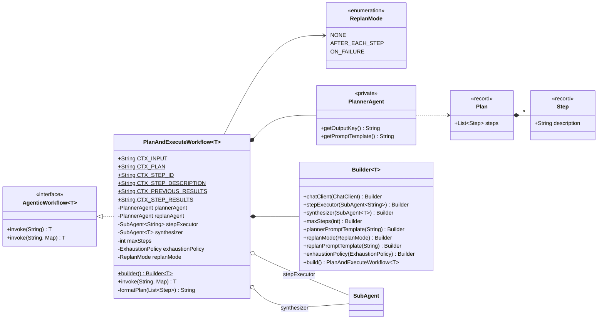

# Plan & execute — `PlanAndExecuteWorkflow<T>`

A planner decomposes the task into an ordered list of steps. A step executor runs each step in
turn, seeing everything the earlier steps produced. A synthesizer folds all the results into one
typed answer.

**Use it when** the work is open-ended enough that you cannot hard-code the stages, but ordered
enough that a plan is worth making: research reports, multi-part analyses, "investigate X and
write it up".

**Don't use it when** the stages are known in advance — a [sequential chain](sequential-agent-chain.md)
does that with one fewer LLM call and no planning risk — or when the next action depends on what
the last one *observed*, which is [ReAct](react-workflow.md).

The difference from ReAct in one line: **by default, the plan is fixed before execution starts.**
Steps can read earlier results, but the step list itself never changes — unless `replanMode` says
otherwise; see [Re-planning](#re-planning) below.

---

## Architecture



`plannerAgent` and `replanAgent` are both instances of the same private `PlannerAgent` class,
built from the same `chatClient` — they differ only in which prompt template they render, so
adding re-planning cost no new public type.

The planner is internal — you supply a `ChatClient` and, optionally, a prompt template. The step
executor and synthesizer are yours.

### Execution

```mermaid
sequenceDiagram
    autonumber
    participant C as Caller
    participant W as Workflow
    participant P as PlannerAgent<br/>(plan or replan)
    participant X as stepExecutor
    participant S as synthesizer

    C->>W: invoke(input)

    rect rgba(128,128,128,0.08)
    Note over W,P: Phase 1 — Plan
    W->>P: execute({input, maxSteps})
    P-->>W: Plan(steps) via typed output
    alt plan is null or empty
        W--xC: IllegalStateException
    else steps.size() > maxSteps
        Note over W: THROW → WorkflowExhaustedException<br/>RETURN_PARTIAL → keep first maxSteps, log what was dropped
    end
    end

    rect rgba(128,128,128,0.08)
    Note over W,X: Phase 2 — Execute (with optional re-planning)
    loop while queue is non-empty and the total budget allows
        W->>X: execute({input, plan, stepId, stepDescription, previousResults})
        alt ON_FAILURE and X throws
            Note over W: result := "FAILED - ..."; queue cleared
        else
            X-->>W: String result
        end
        Note over W: append to previousResults and stepResults
        alt AFTER_EACH_STEP, or ON_FAILURE and this step just failed
            W->>P: execute({input, stepResults, maxSteps=remaining}) — the replan prompt
            alt planner returns steps
                Note over W: replace the queue with them
            else planner returns an empty list
                Note over W: queue stays empty — the task is done
            end
        end
    end
    end

    rect rgba(128,128,128,0.08)
    Note over W,S: Phase 3 — Synthesize
    W->>S: execute({input, plan, stepResults})
    S-->>W: T
    end

    W-->>C: T
```

Cost under `ReplanMode.NONE` is `1 + n + 1` LLM calls for an *n*-step plan — plan, each step,
synthesis. Under `AFTER_EACH_STEP` it is `1 + 2n + 1` — a replan call after every one of the *n*
steps that actually run. Under `ON_FAILURE` it is `1 + n + 1`, plus one replan call per failure.

---

## Context keys

**Planner** (internal):

| Key | Value |
|---|---|
| `input` | The original task. |
| `maxSteps` | The configured budget, as a string — the default template asks for "between 2 and {maxSteps} steps". |

**Step executor**, fresh on every step:

| Key | Value | Constant |
|---|---|---|
| `input` | The original task. | `CTX_INPUT` |
| `plan` | The whole plan, formatted `1. …\n2. …`. | `CTX_PLAN` |
| `stepId` | Current step number, 1-based, as a string. | `CTX_STEP_ID` |
| `stepDescription` | This step's description. | `CTX_STEP_DESCRIPTION` |
| `previousResults` | All earlier results, as `Step N: <result>` blocks. Empty on step 1. | `CTX_PREVIOUS_RESULTS` |

**Synthesizer**, once at the end:

| Key | Value | Constant |
|---|---|---|
| `input` | The original task. | `CTX_INPUT` |
| `plan` | The formatted *initial* plan — see the re-planning note below. | `CTX_PLAN` |
| `stepResults` | Every result labelled `Step N — <description>:` then the text. | `CTX_STEP_RESULTS` |

`previousResults` and `stepResults` are two views of the same work: the terse one for executing,
the labelled one for writing up.

**Replanner** (internal, only called when `replanMode` is not `NONE`):

| Key | Value |
|---|---|
| `input` | The original task. |
| `stepResults` | Every result produced so far, same format as the synthesizer sees. |
| `maxSteps` | The **remaining** budget (`maxSteps - stepsExecutedSoFar`), not the original total — the one context key reused across both planner roles with a different meaning in each. |

### Re-planning

Both `plan` (step executor and synthesizer) and the step executor's `stepId` numbering stay
anchored to the *first* plan and the *running total*, never reset: `plan` always shows what the
planner originally proposed even after a replan changes what actually runs, and `stepId` keeps
counting up (`"3"`, `"4"`, …) across replans rather than restarting at `"1"`. Only
`previousResults` / `stepResults` and the replanner's own `stepResults` view are always current.

---

## Implementing one

### 1. Write a step executor that is told which step it is on

One agent runs every step, so its prompt must orient itself from the context:

```java
DefaultPromptSubAgent stepExecutor = DefaultPromptSubAgent.builder()
        .chatClient(chatClient)
        .outputKey("stepResult")
        .systemPrompt("""
                You are a knowledgeable research specialist executing one step of a structured
                research plan. Focus exclusively on the current step. Use insights from previous
                steps where relevant. Be thorough, factual, and concise.
                """)
        .promptTemplate("""
                Research task: {input}

                Full plan:
                {plan}

                Results from previous steps:
                {previousResults}

                Current step {stepId}: {stepDescription}

                Execute this step thoroughly and provide a detailed, well-structured response.
                """)
        .build();
```

"Focus exclusively on the current step" earns its place — without it, a model handed the full
plan tends to answer the whole task on step 1 and then repeat itself.

### 2. Write a synthesizer

```java
DefaultPromptSubAgent synthesizer = DefaultPromptSubAgent.builder()
        .chatClient(chatClient)
        .systemPrompt("""
                You are an expert analyst producing a final research report. Synthesize all step
                results into a cohesive, well-structured report. Eliminate redundancy, resolve
                contradictions, and highlight key insights.
                """)
        .promptTemplate("""
                Research task: {input}

                Plan that was executed:
                {plan}

                Step-by-step research results:
                {stepResults}

                Produce a comprehensive final report with clear sections, key findings,
                and a concise summary.
                """)
        .build();
```

This is the slot that types the workflow. `SubAgent<T>` here means `PlanAndExecuteWorkflow<T>`
returns `T` — and unlike the sequential chain, the builder really does accept a typed agent:

```java
// typed output: the synthesizer returns a record, not a String
class ReportSynthesizer extends AbstractPromptSubAgent<Report> {
    ReportSynthesizer(ChatClient c) { super(c, Report.class); }
    @Override public String getOutputKey() { return null; }
    @Override public String getPromptTemplate() { return "..."; }
}

PlanAndExecuteWorkflow<Report> workflow = PlanAndExecuteWorkflow.<Report>builder()
        .synthesizer(new ReportSynthesizer(chatClient))
        // ...
        .build();
```

### 3. Assemble

```java
AgenticWorkflow<String> workflow = PlanAndExecuteWorkflow.<String>builder()
        .chatClient(chatClient)        // used by the internal planner
        .stepExecutor(stepExecutor)
        .synthesizer(synthesizer)
        .maxSteps(6)
        .build();

String report = workflow.invoke(topic);
```

Working end-to-end version:
[`PlanAndExecuteWorkflowExample`](../../example/src/main/java/com/ronald/agent/example/PlanAndExecuteWorkflowExample.java).

### 5. Optionally let it replan

The same `stepExecutor` and `synthesizer` work unchanged — only the builder call differs:

```java
AgenticWorkflow<String> workflow = PlanAndExecuteWorkflow.<String>builder()
        .chatClient(chatClient)
        .stepExecutor(stepExecutor)
        .synthesizer(synthesizer)
        .replanMode(PlanAndExecuteWorkflow.ReplanMode.AFTER_EACH_STEP)
        .maxSteps(6)
        .build();
```

See `PlanAndExecuteWorkflowExample.researchWithReplanning` for the full version, and
[Re-planning](#re-planning) above for exactly what each mode does and does not re-run.

### 4. Optionally steer the planner

The default template asks for concrete, ordered, independently executable steps that build on
each other, between 2 and `maxSteps` of them. Override it to constrain the shape of plans:

```java
.plannerPromptTemplate("""
        Decompose this engineering task into an ordered list of steps.

        Rules:
        - Every step must be verifiable by reading code or running a test.
        - No step may require information from a later step.
        - Produce between 3 and {maxSteps} steps.

        Task: {input}
        """)
```

Keep both `{input}` and `{maxSteps}` — the default template uses them and the planner has no
other way to learn the budget. (Unlike the conditional router, this is not validated at build
time; a template missing `{maxSteps}` simply renders without it, and the plan may overrun.)

The planner returns typed output: Spring AI derives a schema from the `Plan(List<Step>)` record
and deserializes the model's JSON into it. You do not describe the output format in the prompt.

---

## The step budget

`maxSteps` is both a hint to the planner and a hard cap on execution — and the two can disagree.
There are two distinct places this surfaces, and they carry different partial results.

**The initial plan is too long.** When the planner's first response already exceeds `maxSteps`:

| Policy | Behaviour |
|---|---|
| `THROW` *(default)* | `WorkflowExhaustedException`; `getPartialResult()` is the **full formatted plan** that could not be run, `getLimit()` is `maxSteps`. Nothing executes, so nothing is spent beyond the planning call. |
| `RETURN_PARTIAL` | Executes the first `maxSteps` steps, logs a `WARN` naming how many were dropped, and synthesizes from what ran. |

The default is strict for a specific reason spelled out in the code: truncating silently would
hand the synthesizer a partial plan and let it present an incomplete report as a complete one.
The failure is visible instead.

`RETURN_PARTIAL` is reasonable when the plan is front-loaded — the important work happens early
and the tail is polish. It is a bad idea when step *n* is the conclusion.

**The budget runs out mid-run, under re-planning.** `maxSteps` is a *total* across every plan and
replan combined — not reset each time the planner is asked again. When a replan would need to
execute another step but none of the budget is left:

| Policy | Behaviour |
|---|---|
| `THROW` *(default)* | `WorkflowExhaustedException`; `getPartialResult()` is **every result produced so far** (`stepResults`, not the plan text), `getLimit()` is `maxSteps`. |
| `RETURN_PARTIAL` | Logs a `WARN` and synthesizes over the results produced so far. |

This case cannot arise under `ReplanMode.NONE`: the initial-plan check above already guarantees
the fixed plan never exceeds `maxSteps`. Reaching the exact boundary with the planner reporting
the task already done is a normal completion, not exhaustion — see the gotchas below.

---

## Builder reference

| Method | Default | Notes |
|---|---|---|
| `chatClient(ChatClient)` | — | Required. Used **only** by the internal planner. |
| `stepExecutor(SubAgent<String>)` | — | Required. Must return `String`. |
| `synthesizer(SubAgent<T>)` | — | Required. Types the workflow. |
| `maxSteps(int)` | `10` | Must be ≥ 1. Caps both the plan and the total number of steps ever executed, across every replan. |
| `plannerPromptTemplate(String)` | built-in | Should contain `{input}` and `{maxSteps}`. |
| `replanMode(ReplanMode)` | `NONE` | `AFTER_EACH_STEP` or `ON_FAILURE` — see [Re-planning](#re-planning). |
| `replanPromptTemplate(String)` | built-in | Only rendered when `replanMode` is not `NONE`. Should contain `{input}`, `{stepResults}` and `{maxSteps}` (the *remaining* budget). |
| `exhaustionPolicy(ExhaustionPolicy)` | `THROW` | Applies both to an over-budget initial plan and to the budget running out mid-replan. |

### Validation

| Check | Exception |
|---|---|
| Missing `chatClient`, `stepExecutor`, or `synthesizer` | `NullPointerException` |
| `maxSteps < 1` | `IllegalArgumentException` |
| Null `replanMode` | `NullPointerException` |
| Planner returns null / empty plan | `IllegalStateException` at invoke time, naming the input |
| Plan longer than `maxSteps` under `THROW` | `WorkflowExhaustedException` |

---

## Failure modes

| Situation | Result |
|---|---|
| `invoke(null)` | `NullPointerException` |
| Planner or replanner output won't deserialize into `Plan` | Propagates from Spring AI's structured-output conversion |
| Empty initial plan | `IllegalStateException` — "Planner produced an empty plan for input: …" |
| A step throws, under `NONE` or `AFTER_EACH_STEP` | Propagates immediately; earlier steps' work is lost |
| A step throws, under `ON_FAILURE` | **Not** propagated — recorded as `"FAILED - <ExceptionClass>: <message>"` and handed to the replanner instead |
| Synthesizer throws | Propagates; every step has already been paid for |

Under `ReplanMode.NONE` (and for `AFTER_EACH_STEP`, since it never catches a step's exception)
there is no per-step retry and no partial synthesis on a mid-run failure: a step that fails at *n*
of 6 discards the *n−1* completed steps. If a step is flaky under those modes, put the retry
inside the `stepExecutor` agent. `ON_FAILURE` exists precisely to give the *planner* a chance to
react to a failure instead — see [Re-planning](#re-planning).

---

## Gotchas

**Every step gets the whole plan and every previous result.** `previousResults` grows on each
iteration, so prompt tokens grow roughly quadratically across a run. A 10-step plan over verbose
steps can get expensive; keep the executor's output disciplined ("be concise" is doing real work
in that system prompt).

**The plan is fixed once made.** A step that discovers the plan was wrong has no way to revise
it. That is the trade against ReAct — cheaper and more predictable, less adaptive.

**A bad plan is unrecoverable.** Planning is one LLM call with no validation beyond "non-empty"
and the step count. Everything downstream inherits its mistakes. When plans come out poorly
shaped, fix `plannerPromptTemplate` before touching the executor.

**`maxSteps` is advisory to the planner.** It arrives as a prompt variable; models overshoot. The
budget check exists precisely because the hint is not binding.

**`stepId` is a `String`.** The context is `Map<String,String>` — it's `"1"`, `"2"`, not an int.

**The step executor's `outputKey` is unused.** Results are accumulated into `previousResults` and
`stepResults` by position, not by key. Setting it is harmless.

**Under `AFTER_EACH_STEP`, only the first step of every plan or replan ever executes.** The
workflow clears the queue and asks the planner again immediately after *any* step completes, so a
response proposing several steps only ever contributes its first one — the rest are discarded
unexecuted the moment the next replan happens. This applies to the *initial* plan too: a 4-step
first plan under `AFTER_EACH_STEP` runs only step 1 before replanning. It is not a bug to work
around; it is what "ask again after every step" means. If you want a multi-step response to run
in full before the planner is consulted again, `ReplanMode.NONE` (no replanning) or
`ReplanMode.ON_FAILURE` (replans only on a thrown exception, otherwise follows the plan as given)
fit better.

**`ON_FAILURE` replaces the rest of the plan, it does not insert recovery steps alongside it.**
When a step fails, whatever remained of the *original* plan is discarded exactly like
`AFTER_EACH_STEP` discards it — the replanner's response becomes the entire remaining plan, not
an addition to it. If the original plan's later steps are still relevant after a recoverable
failure, the replan prompt needs to be told what they were (e.g. by including the formatted
`plan` in a custom `replanPromptTemplate`), since the default template only shows `stepResults`.

**Re-planning costs real model calls.** `AFTER_EACH_STEP` asks the planner once per step that
actually runs, roughly doubling the planning cost of a `NONE` run of the same length.
`ON_FAILURE` costs nothing extra when nothing fails, which is the common case it is meant for.

**Reaching the budget exactly is not exhaustion.** If the last replan the budget allows reports
an empty list (the task is done), the workflow completes normally — `ReplanMode` always asks one
final time at the boundary rather than assuming exhaustion, specifically so this case is
distinguishable from genuinely running out with real work still pending.
