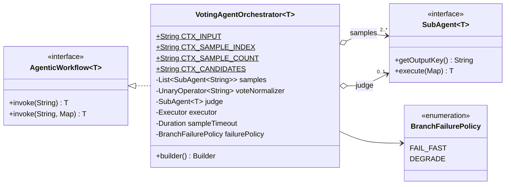
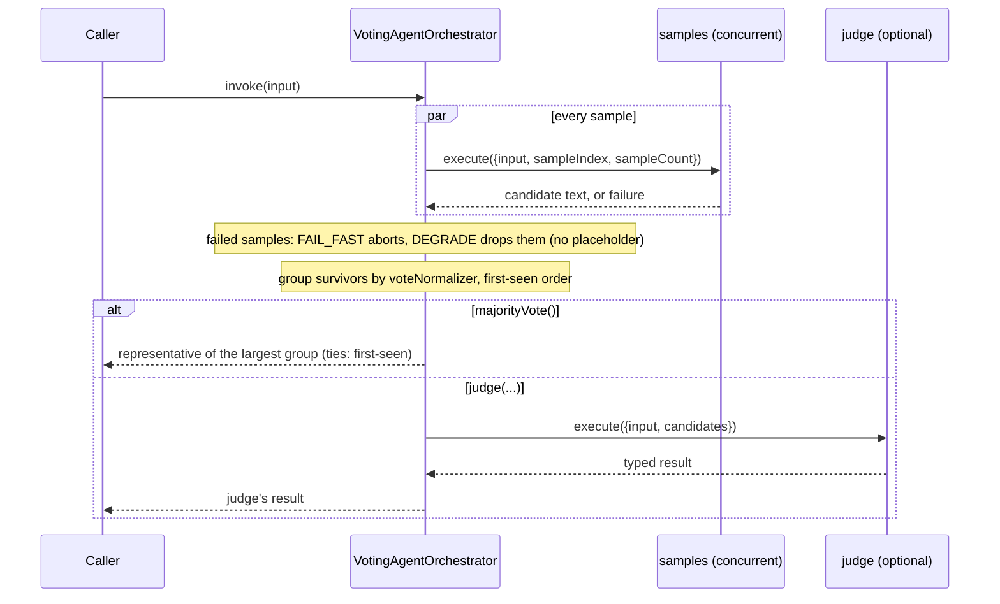

# Voting / Ensemble — `VotingAgentOrchestrator<T>`

Several candidate invocations answer the same question concurrently; the workflow picks one
final answer either by majority vote or by handing every distinct candidate to a typed judge.

**Use it when** a single model call is an unreliable coin flip on a hard or borderline input, and
running it several times (relying on the model's own sampling variance) or across a small ensemble
of differently-prompted agents and combining the answers is cheaper than building a bespoke
evaluator loop.

**Don't use it when** the branches each do different work that must be combined into one report —
that's [parallel orchestration](parallel-agent-orchestrator.md), with a custom aggregator agent
instead of a vote. And don't use it for a single draft that must pass a check before it ships —
that's [iterative refinement](iterative-refinement-workflow.md) (self-correction against
criteria) or [human review](human-review-sub-agent.md) / [guardrails](guardrail-sub-agent.md)
(an approval gate), not a quorum of independent answers.

The difference from parallel orchestration in one line: **every branch answers the same question
and the workflow decides which answer to keep, instead of each branch contributing a different
piece of one report.**

---

## Architecture

### Execution

| Step | Detail |
|---|---|
| Fan-out | One invocation per entry in the candidate list — the same agent run `times` times, a different agent added once, or any mix, all concurrent on the configured `Executor`. |
| Grouping | Survivors are grouped by exact text match after `voteNormalizer` (default `String::strip`). A group's representative is the first raw (un-normalized) text seen for that key. |
| Majority vote | The group with the most members wins; a tie goes to whichever group was seen first. No further model call. |
| Judge | Every group, annotated `(count/total samples agreed)`, is formatted into `{candidates}` and handed to a typed judge agent, which produces the final `T`. |

---

## Context keys

Every sample receives a copy of the workflow's context with three keys added:

| Key | Constant | Meaning |
|---|---|---|
| `input` | `CTX_INPUT` | The original input, unchanged across every sample. |
| `sampleIndex` | `CTX_SAMPLE_INDEX` | This sample's 1-based position in the candidate list — fixed before dispatch, not by completion order. |
| `sampleCount` | `CTX_SAMPLE_COUNT` | The total number of samples. |

A judge agent instead receives `input` and:

| Key | Constant | Meaning |
|---|---|---|
| `candidates` | `CTX_CANDIDATES` | Every distinct surviving candidate, each annotated with how many samples agreed on it, e.g. `Candidate 1 (3/5 samples agreed):\n...`. |

`majorityVote()` makes no judge call at all, so `{candidates}` is never rendered in that mode.

---

## Failure handling

Each sample is bounded by `sampleTimeout` (60 seconds by default) and recovered according to
`BranchFailurePolicy` — the same shape as [parallel orchestration](parallel-agent-orchestrator.md)
and [orchestrator-workers](orchestrator-workers-workflow.md), kept as its own type for the same
reason theirs are: independent patterns that should not have to share a public enum just because
their fan-out mechanics look alike.

| Policy | Effect |
|---|---|
| `FAIL_FAST` (default) | Any sample failure or timeout aborts the workflow; the failure propagates as `CompletionException` with the original cause. |
| `DEGRADE` | The failed sample is dropped from the vote — unlike this library's other `DEGRADE` policies, it contributes **no placeholder text**. A placeholder could win a vote on an otherwise-tied field, or be read by the judge as a genuine (if useless) candidate, so voting excludes it outright instead. |

If every sample fails under `DEGRADE`, there is nothing to aggregate and `invoke` throws
`IllegalStateException` naming how many samples were attempted.

---

## Builder reference

| Method | Default | Notes |
|---|---|---|
| `addCandidate(SubAgent<String>)` | — | Adds one sample: the agent is invoked once. |
| `addCandidate(SubAgent<String>, int times)` | — | Adds `times` independent samples of the same agent. Call it again with a different agent to ensemble across prompts or models instead of (or alongside) repetition. At least 2 samples total are required. |
| `majorityVote()` | — | Selects majority-vote aggregation. Mutually exclusive with `judge(...)`. Requires `T` to be `String`. |
| `judge(SubAgent<T>)` | — | Selects judge aggregation. Mutually exclusive with `majorityVote()`. |
| `voteNormalizer(UnaryOperator<String>)` | `String::strip` | Controls grouping only; the returned/representative text is always the original, un-normalized candidate. |
| `executor(Executor)` | — | **Required.** Runs samples concurrently. |
| `sampleTimeout(Duration)` / `noSampleTimeout()` | 60s | Per-sample wait bound; bounds the wait, not the underlying call. |
| `failurePolicy(BranchFailurePolicy)` | `FAIL_FAST` | See above. |

### Validation

`build()` throws `IllegalStateException` for fewer than 2 samples, or if `majorityVote()` and
`judge(...)` are both set or neither is set; `NullPointerException` for a missing `executor`.
`addCandidate(agent, times)` throws `IllegalArgumentException` for `times < 1`.

---

## Gotchas

- **`majorityVote()` requires `VotingAgentOrchestrator<String>`.** The winning candidate's own
  text is cast to `T`; nothing enforces this at compile time beyond the type parameter you declare
  on `.<T>builder()` — the same convention `SequentialAgentChain`'s final step uses.
- **Exact-match voting is unforgiving of wording variance.** Two semantically identical but
  differently-phrased free-form answers form two separate groups and split the vote. For anything
  beyond a short label or classification, prefer `judge(...)`, which sees every distinct answer and
  can recognize agreement a human would.
- **Samples are not guaranteed diverse on their own.** Running the same agent `times` times relies
  entirely on the model's own sampling (temperature, etc.) for variety; a deterministic agent run
  five times just produces five identical votes. Use `addCandidate` with different agents (distinct
  prompts, system messages, or models) when you need engineered diversity rather than sampling luck.
- **`addCandidate` stores the same instance repeatedly.** A candidate agent invoked with `times > 1`
  is called concurrently, from multiple threads, on that one instance — it must be safe to invoke
  concurrently, which `DefaultPromptSubAgent` and other `ChatClient`-backed agents already are.
